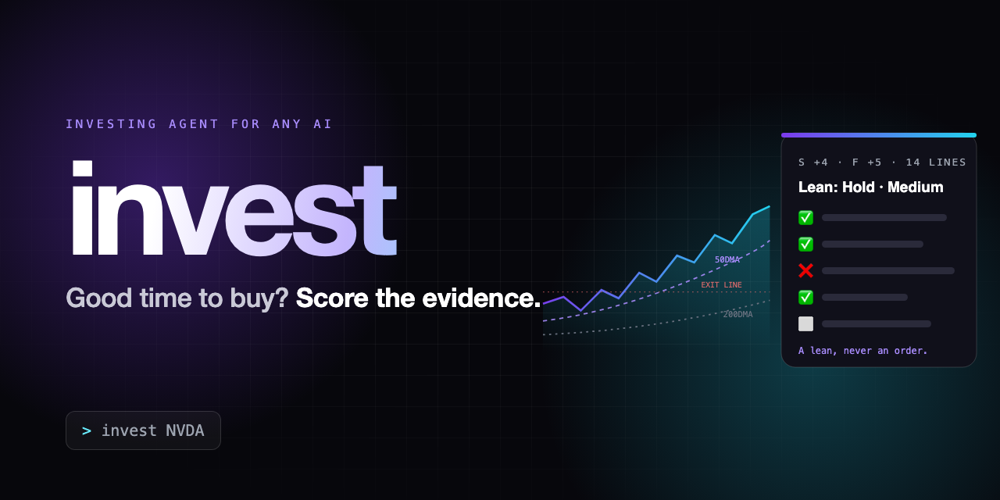

<p align="center"></p>

# Investing Agent

Ask "is it a good time to buy NVDA?" and get the evidence instead of a guess. The agent works like
a quant desk: it scores 14 technical lines and 9 fundamental lines from live data, your own rules
and published research. The result is a **lean** (Buy lean · Hold · Sell lean · No edge) with a
**conviction** (Low / Medium / High), shown as a ✅ / ❌ / ⬜ checklist. It ends with a few IF/THEN
actions sized from a 2% risk budget.

It never places orders and never sets price targets. Every number comes from a data call made in
that run, or it shows as ⬜ unknown. You make the trade, in your own broker.

## What a read looks like

```
NVDA.US · 217.23 USD (15 Oct close) · 14:58 HKT Fri 16 Oct · market closed
Lean: No edge · Conviction Med — Long trend and momentum are strong, but price sits under
its 50DMA (217.23 vs 223.06), so Stage 2 is not confirmed and the Buy-lean bar is unmet.
Scorecard: 技術面 S = +6 (10✅ 4❌ 0⬜ of 14) · 基本面 F = +5 (6✅ 1❌ 2⬜ of 9)

News         🟢 Positive / 🔴 Negative table, dated, with sources
基本面        profitable · beat estimates · valuation vs peers and vs its own range · analysts …
技術面        Stage 2 · 200DMA · MA order · 12m and 12-1 momentum · z-score · RSI/MACD · volume
             volatility regime · beta · relative strength · market regime · panic state

Break line · Size if you act (2% risk) · Flip triggers
Suggested action   A. do nothing (default)   B. IF <trigger> THEN consider <size>, exit IF …
```

Full example, with the news table, every line and the script output: [`examples/nvda.md`](examples/nvda.md).

## How the lean is decided

The lean follows a fixed formula, so two reads of the same chart give the same answer:

- **S** = number of ✅ minus number of ❌ across the 14 technical lines. **F** does the same for the 9 fundamental lines.
- **Buy lean** needs Stage 2 confirmed, S ≥ +6 and a positive 12-month return. That's deliberately a
  higher bar than Hold (it costs money to open a position and not to keep one).
- **Sell lean** (only for something you hold): a close below the 50-day average, Stage 4, or S ≤ −4.
- **Conviction** comes from |S| and drops a level when volatility is rising, beta is above 1.5, the
  market is in a panic state, or three or more lines are unknown.

Each line cites its rule. `R-` rules are yours (12 common stage-analysis rules to start). `W-`
rules come from published research: time-series and 12-1 momentum, short-term reversal, momentum
crashes, trend filters, betting-against-beta, volatility management, trading costs, and
backtest-overfitting standards. Sources are in [`RESEARCH.md`](RESEARCH.md). When the two disagree,
your rule wins.

## Works with or without live market data

| You have | How it gets the numbers | Start here |
|---|---|---|
| **A. Claude Code + the Longbridge MCP** | Live quotes, candles, news and fundamentals, every run | [`agent/invest.md`](agent/invest.md) |
| **B. Any AI that can run Python** (Claude Code, Codex, Cursor, ChatGPT with code) | `tools/indicators.py` fetches 2 years of daily prices and the benchmark from Yahoo Finance, or reads a CSV. No API key. | [`tools/indicators.py`](tools/indicators.py) |
| **C. A chat AI with no tools** (ChatGPT, Gemini, Perplexity, Claude.ai) | It asks you for a short fill-in list you can read off Yahoo Finance or your broker app | [`PROMPT.md`](PROMPT.md) |

Every route uses the same rules and the same format. Fewer numbers means more ⬜ and lower
conviction, which is the honest result.

## Quick start

**C. Any chat AI (2 minutes)**
1. Copy all of [`PROMPT.md`](PROMPT.md) and paste it as your first message (or into a custom GPT,
   Gem, Project or Space).
2. Ask: "Is it a good time to buy NVDA?" and answer its fill-in list.

**B. Run the script yourself, then paste the output into any AI**
```bash
python3 tools/indicators.py --yahoo NVDA --risk 100 --pot 5000   # risk = 2% of a 5,000 pot
python3 tools/indicators.py my_prices.csv --bench spy.csv         # any CSV with Date, High, Low, Close, Volume
```
Python 3.8+, standard library only. It prints moving averages, the Stage 2 checklist, RSI, MACD,
swing levels, and a QUANT block: volatility, 1/3/6/12-month and 12-1 momentum, drawdown, Sharpe
proxy, z-score, ATR, beta, and a position size. The Yahoo endpoint is public but unofficial; if it
breaks, download a CSV from Yahoo Finance's "Historical Data" page or your broker.

**Claude Code (skill, routes B and C)**
```bash
git clone https://github.com/klmiing1229-a11y/Investing_Agent ~/.claude/skills/investing_agent
```
Then start a message with `invest`, e.g. `invest NVDA`.

**A. Claude Code with live data (agent)**
1. Clone as above, connect the Longbridge MCP, and copy the agent in:
   `cp ~/.claude/skills/investing_agent/agent/invest.md ~/.claude/agents/`
2. If your Longbridge server isn't the claude.ai connector, change the `mcp__claude_ai_Longbridge__`
   prefix in the agent's `tools:` line to your server's name.
3. Ask "Is it a good time to buy 700.HK?"

The agent can only use 24 **read-only** Longbridge tools. Every order, account, position, alert
and watchlist tool is left out on purpose, so it cannot trade or see your account.

## Learn quant trading with it

`invest next lesson` works through a 15-topic syllabus ([`QUANT_SYLLABUS.md`](QUANT_SYLLABUS.md)):
returns, volatility, Sharpe and drawdown, beta, trend following, momentum, momentum crashes,
factors, position sizing, Kelly, backtesting traps, trading costs, crypto factors, and what quant
jobs actually involve. Each lesson starts with the formula, explains every symbol, works an example
with real numbers from a ticker you name, and ends with 3 quiz questions. A wrong answer gets
a follow-up question of the same kind.

## Teach it your own rules

```
learn: <your notes from a course, book or talk>
```

It turns the notes into numbered rules (R-013, R-014, …), flags any that contradict existing rules,
and from then on its reads cite them. Chat AIs hand you the lines to paste into `KB.md`; Claude
Code writes them in itself.

## Check how its reads did

`how did my reads do?` compares every saved read with today's price: was the lean right, and was the
break line hit. Under 30 scored reads, the hit rate is labelled **anecdotal**. A handful of reads
proves nothing.

## Optional: your position

Copy [`PORTFOLIO.example.md`](PORTFOLIO.example.md) to `PORTFOLIO.md` with a rough picture of your
pot. Reads then size from your real risk budget, know what you already hold, and respect any date
you need the cash back. Don't put account numbers or logins in it.

## Files
```
PROMPT.md               the whole method, for any AI
SKILL.md                Claude Code skill wrapper (trigger: "invest")
KB.md                   the rules: R- (yours) and W- (research), grows with LEARN mode
RESEARCH.md             every W- rule's source, with links
QUANT_SYLLABUS.md       the 15-topic teaching order
agent/invest.md         Claude Code subagent for live Longbridge data
tools/indicators.py     the maths: MAs, Stage 2, RSI, MACD, levels + QUANT block
PORTFOLIO.example.md    optional template for pot, holdings and sizing
examples/               a real read
```

## Limits
- **Not financial advice.** It is a structured way to weigh evidence, for education.
- The research behind the `W-` rules is about portfolios of thousands of positions, not one share.
  Nothing here is a backtest on your tickers, and the agent never claims a proven edge.
- Chart rules describe the past. A read that looks fine can still fail on news.
- Using stock rules on crypto or thin markets is an extrapolation, and the read says so.
- It doesn't pick what to buy, build portfolios, handle tax or place trades.

MIT licence.
